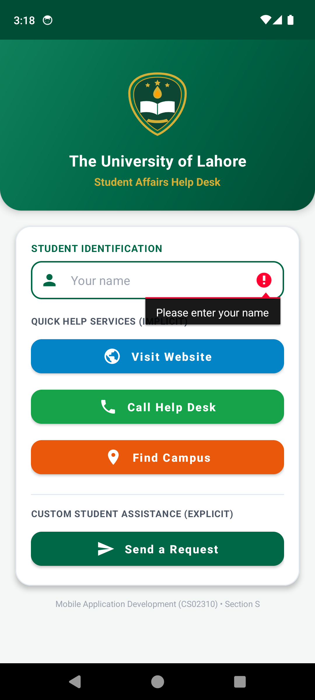
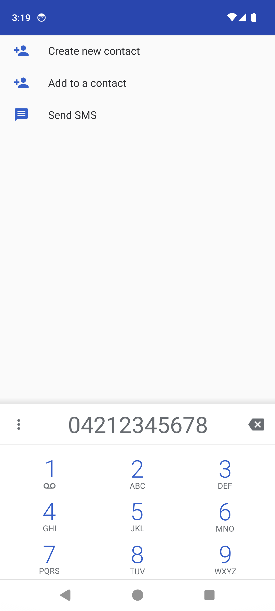
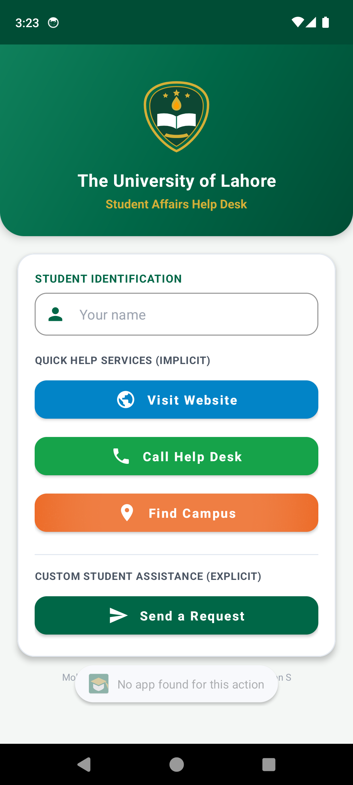
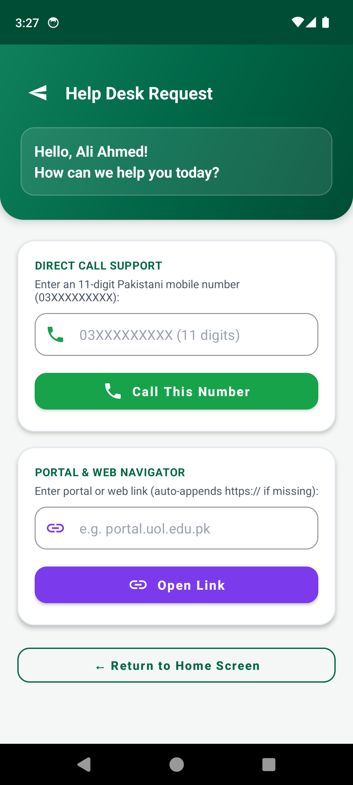
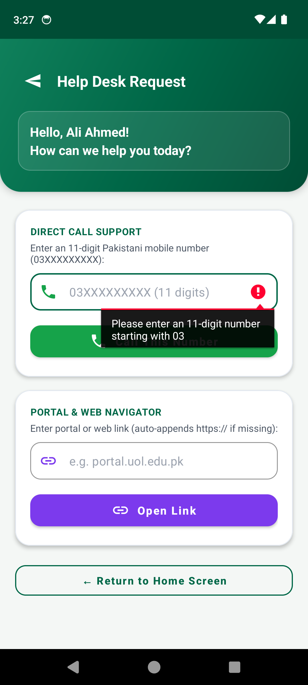
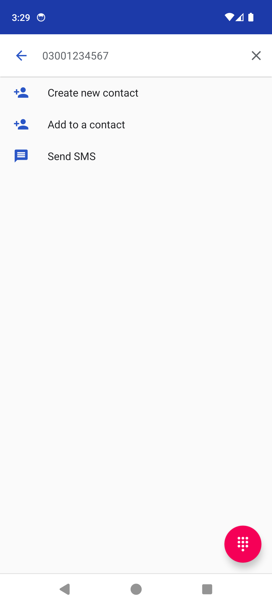
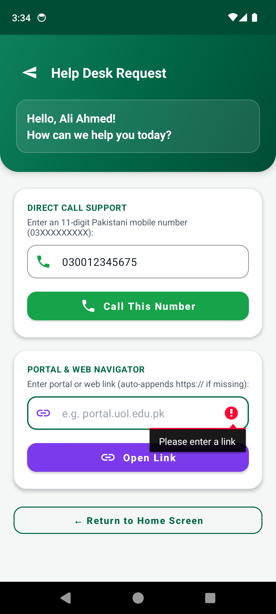

# UOL Help Desk — Mobile Application Development (CS02310)

**The University of Lahore**  
**Faculty of Information Technology | Department of Software Engineering**  
**Course:** Mobile Application Development (CS02310) — Section S  
**Student Name:** Aimish Umar | **SAP ID:** 70147829  
**Lab Task:** Multi-Screen App using Implicit and Explicit Intents with Input Validation  

---

## 📋 Project Overview

**UOL Help Desk** is an Android application built for the Student Affairs Office that allows students to reach university services in one tap. The application integrates two linked scenarios:

1. **Scenario 1 — Home Screen (Implicit Intents):**
   - Features the University of Lahore logo, student identification field (`etName`), and three quick-access buttons that launch external apps via implicit intents:
     - **Visit Website (`btnWebsite`):** Opens `https://www.uol.edu.pk` in the web browser via `Intent.ACTION_VIEW`.
     - **Call Help Desk (`btnCall`):** Opens the phone dialer with `tel:04212345678` pre-filled via `Intent.ACTION_DIAL`.
     - **Find Campus (`btnMap`):** Opens Maps with `geo:0,0?q=University+of+Lahore` via `Intent.ACTION_VIEW`.
   - Formulates a centralized, reusable helper method `public static void openIntent(Context context, Intent intent)` protected by `try-catch` that displays a `Toast` message `"No app found for this action"` when `ActivityNotFoundException` is encountered.

2. **Scenario 2 — The Request Screen (Explicit Intent & Validations):**
   - **Explicit Intent Navigation:** Validates that the student name is not empty (rejecting with `setError("Please enter your name")`), then opens `RequestActivity` via an explicit Intent carrying the name through `putExtra()` with constant `EXTRA_NAME`.
   - **Personalized Greeting:** `RequestActivity` retrieves the name via `getStringExtra()` and displays `"Hello, <name>! How can we help you today?"` (falling back to `"Student"` if absent).
   - **Validated Phone Dialer:** Input field restricted to phone input (`etPhone`), requiring an 11-digit Pakistani mobile number starting with `03` (regex `^03[0-9]{9}$`). Rejects invalid input with `setError()` and launches the dialer using `openIntent()`.
   - **Validated Link Navigator:** Input field (`etLink`) that rejects empty input, automatically prepends `https://` if `http://` or `https://` is missing, and opens the destination in the browser using `openIntent()`.

---

## ⚖️ Implicit vs. Explicit Intents Comparison (Scenario 2, Step 5)

> **1. Explicit Intent:** Specifies the exact target component class (e.g., `new Intent(MainActivity.this, RequestActivity.class)`) to perform deterministic internal navigation within the same app.  
> **2. Implicit Intent:** Specifies only an abstract action and data URI (e.g., `ACTION_VIEW`, `ACTION_DIAL`), delegating execution to the Android OS to identify, resolve, and launch any installed third-party or system application capable of handling the request.

---

## 📸 Application Screenshots

| Scenario 1: Home Screen | Scenario 2: Validation Error | Scenario 1: Browser Opened |
|:---:|:---:|:---:|
|  |  |  |

| Scenario 1: Dialer Opened | Scenario 1: Map Toast Handler | Scenario 2: Request Screen |
|:---:|:---:|:---:|
|  |  |  |

| Scenario 2: Phone Validation | Scenario 2: Custom Dialer | Scenario 2: Link Validation |
|:---:|:---:|:---:|
|  |  |  |

---

## 🛠️ Project Structure

```text
UOLHelpDesk/
├── app/
│   ├── src/
│   │   ├── main/
│   │   │   ├── java/pk/edu/uol/helpdesk/
│   │   │   │   ├── MainActivity.java        # Home screen logic & openIntent() helper
│   │   │   │   └── RequestActivity.java     # Second screen, greeting & input validations
│   │   │   ├── res/
│   │   │   │   ├── layout/
│   │   │   │   │   ├── activity_main.xml    # UI for Home screen
│   │   │   │   │   └── activity_request.xml # UI for Request screen
│   │   │   │   ├── drawable/                # UOL logo & custom Material icons
│   │   │   │   └── values/                  # Strings, colors, and Material themes
│   │   │   └── AndroidManifest.xml          # Activity declarations & Intent queries
│   │   └── test/java/pk/edu/uol/helpdesk/
│   │       └── ValidationUnitTest.java      # JUnit tests for regex and link logic
│   └── build.gradle.kts
├── screenshots/                             # Verified emulator screenshots
├── LabTask_Report.md                        # Complete Lab Task Report
├── build.gradle.kts
└── settings.gradle.kts
```

---

## 🚀 How to Build and Run

1. Open **Android Studio** (Hedgehog / Iguana / Jellyfish / Ladybug or newer).
2. Select **File -> Open...** and choose the `UOLHelpDesk` folder.
3. Allow Gradle to sync dependencies.
4. Select a virtual device (e.g. `Pixel_API_34`) or physical Android device.
5. Click the green **Run (Shift + F10)** button.
